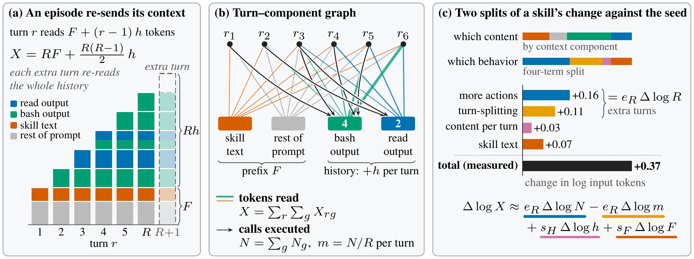
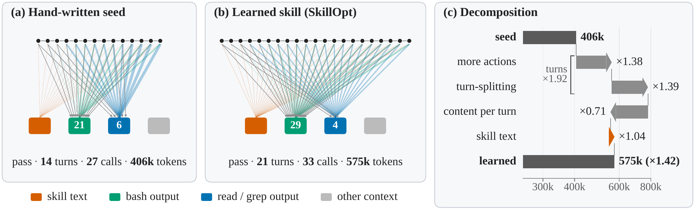
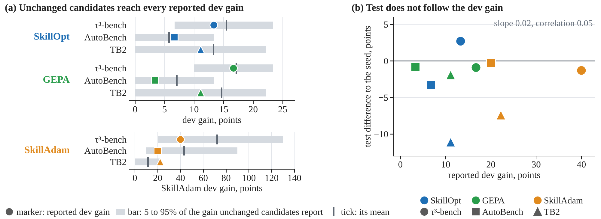
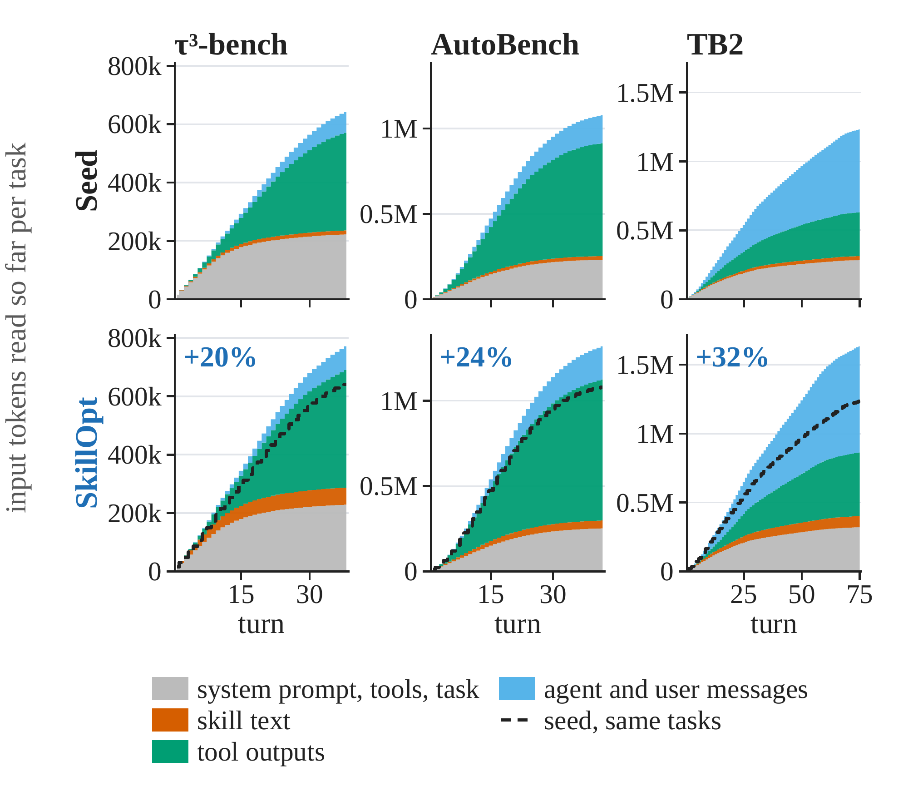
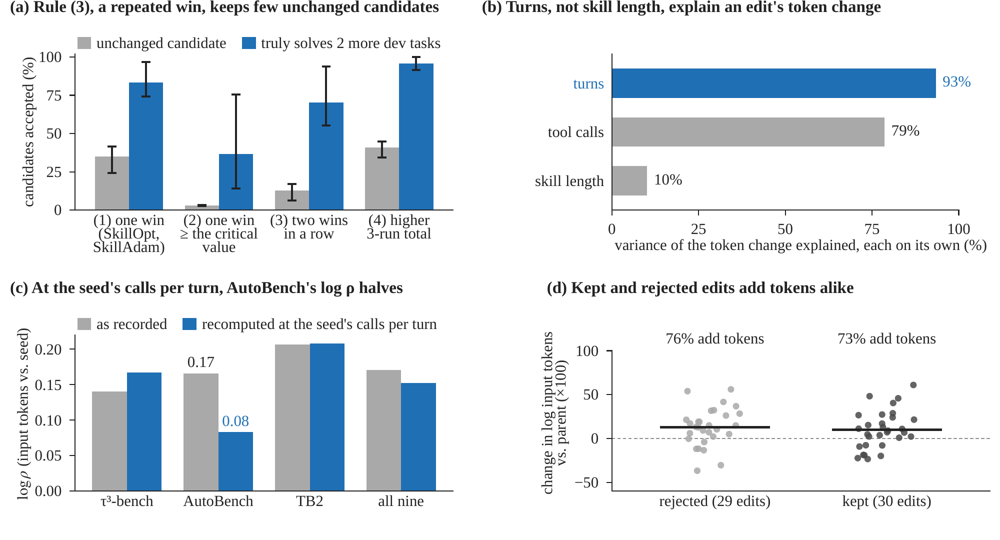
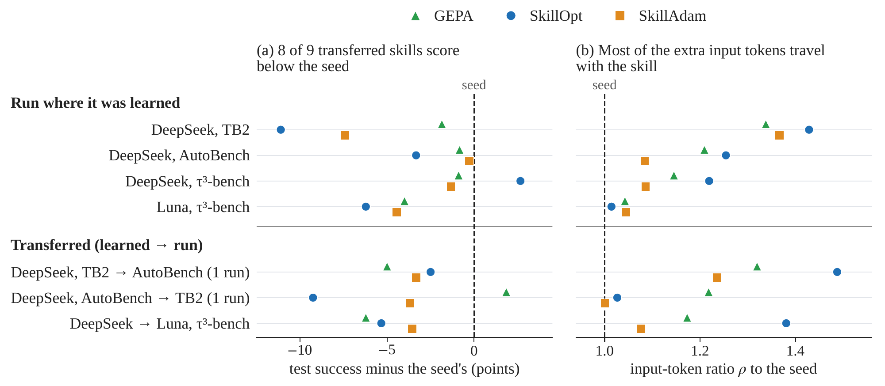

# Does Your Generalist Skill Optimizer Really Incentivize Agentic Tasks? Rethinking Skill Optimization via Bipartite Attribution

[](https://arxiv.org/abs/2610.37201)

BiPA represents each agent episode as a bipartite graph between turns and context components, tracking model input tokens and tool calls. The paper uses this attribution to examine how skill optimization changes success, behavior, and cost.





## Motivation

Skill optimizers accept edits based on success on a small development set. Noise and selecting the best of several candidates can inflate the apparent gain, while success alone does not explain extra agent behavior or input-token cost. BiPA uses bipartite attribution to analyze those changes.

## Results

- Across three optimizers, three benchmarks, and two models, learned skills average only +0.1 percentage points in success over the hand-written seed.
- Development gains disappear on test. Selecting the best of several seed-identical candidates on development sets of at most 30 tasks produces similarly inflated gains.
- Learned skills read about 16% more input tokens, mainly because recheck and one-call-at-a-time rules add turns and repeatedly resend conversation history.



## Run

Python 3.12 is required.

```bash
pip install -e ../harness-bench -e optimizers/skillopt -e 'optimizers/skilladam[backend]' \
    numpy scipy scikit-learn matplotlib openai httpx python-dotenv pyyaml pytest
pip install --no-deps -e optimizers/gepa
cp host.env.example host.env
```

Set the paths in `host.env`:

```bash
export BIPA_ASSETS=/data/bipa/assets
export HARNESS_BENCH_ROOT=/data/harness-bench
export BIPA_OUT=/data/bipa/out
```

Recorded runs are not published with this repository; offline analyses require you to provide these runs under `BIPA_ASSETS`.

> [!CAUTION]
> Agent models are configured in `harness-bench`, which is not released with this repository. Real experiments make live model/API calls and incur costs; a fresh clone cannot run them.

To train and evaluate with live models:

```bash
bash scripts/main.sh train deepseek-flash --execute
```

## Analyses

The `--offline` flag skips aux steps that require model calls. Records are written to `$BIPA_OUT/data/mech`, and figures to `$BIPA_OUT/fig/mech`.

| Command | Result |
|---|---|
| `bash scripts/main.sh table1 --execute` | Table 1 |
| `bash scripts/aux.sh tokens --execute --offline` | Token attribution, turn slopes, and cumulative tokens |
| `bash scripts/aux.sh calls --execute --offline` | Tool calls and serialized writes |
| `bash scripts/aux.sh edits --execute --offline` | Rules, edit lineage, and acceptance gate |
| `bash scripts/aux.sh success --execute --offline` | Paired statistics, run noise, and domain success |
| `bash scripts/aux.sh selection --execute --offline` | Selection replay and dev-vs-test analysis |
| `bash scripts/aux.sh transfer --execute --offline` | Cross-model/benchmark transfer, loading, and contamination |
| `bash scripts/aux.sh three_word_seed --execute --offline` | Three-word-seed analysis |
| `bash scripts/aux.sh all --execute --offline` | All offline analyses |

### Selected analysis figures

**Cumulative input tokens and context components**

SkillOpt reads 20–32% more input tokens across the three benchmarks, mainly through tool outputs and message history.



**Learned skill edits and design implications**

Turn count explains 93% of the token-change variance; skill length explains only 10%.



**Cross-model and cross-benchmark transfer**

Eight of nine transferred skills score below the seed, while most of the extra input-token cost remains.



## Citation

```bibtex
@misc{zhou2026bipa,
  title = {Does Your Generalist Skill Optimizer Really Incentivize Agentic Tasks? Rethinking Skill Optimization via Bipartite Attribution},
  author = {Zhou, Jiawei and Peng, Bo and Huang, Yuxuan and Zhang, Ming and Sun, Youbang and Wang, Xiang and Lu, Chaochao},
  year = {2026},
  eprint = {2610.37201},
  archivePrefix = {arXiv},
  primaryClass = {cs.AI},
  url = {https://arxiv.org/abs/2610.37201}
}
```
